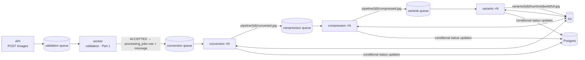
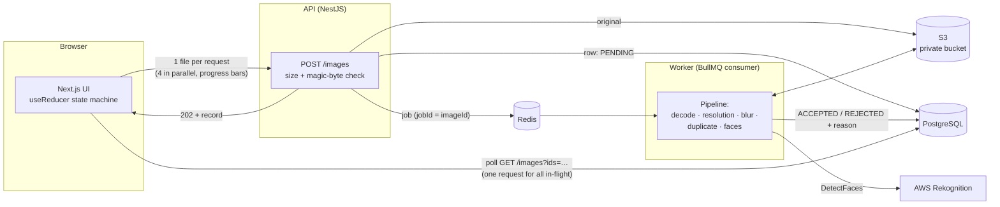

# Photo Upload, Validation & Media Processing Pipeline

Users upload photos of themselves. Each photo is stored, validated in a background worker, and sorted into **Accepted** or **Rejected** with a specific, human-readable reason (Part 1). Accepted photos then flow automatically through a **media pipeline** of three independently scalable services: conversion, compression and variant generation (Part 2).

**Part 2 starts here:** [Media processing pipeline](#part-2-media-processing-pipeline)

**Stack:** Next.js 16 (React 19) · NestJS 11 (Express) · PostgreSQL 16 + Prisma · BullMQ + Redis · S3 (AWS SDK v3) · sharp · AWS Rekognition

**Demo video:** [watch on Google Drive](https://drive.google.com/file/d/1khM1Yhx7AurI5M966Sw4v1M5QbWobF1q/view?usp=sharing)

---

## Contents

1. [Quick start](#quick-start)
2. [**Part 2: Media processing pipeline**](#part-2-media-processing-pipeline)
3. [Architecture](#architecture)
4. [Validation pipeline](#validation-pipeline)
5. [Key decisions and tradeoffs](#key-decisions-and-tradeoffs)
6. [Data model](#data-model)
7. [API](#api)
8. [Security](#security)
9. [Testing](#testing)
10. [QA checklist](#qa-checklist)
11. [AI-Assisted Development](#ai-assisted-development)
12. [What I would do next](#what-i-would-do-next)

---

## Quick start

Requires Node 20.12+, Docker, and an AWS account. Storage is a **private AWS S3 bucket** and face detection is **AWS Rekognition**.

`FACE_DETECTOR=none` (root `.env`) skips the face check and treats every image as one clear face. It exists for load tests with generated images; Rekognition is the default.

### 1. AWS

Create a private S3 bucket and an IAM user with:

- `s3:PutObject`, `s3:GetObject`, `s3:DeleteObject` on `arn:aws:s3:::your-bucket-name/*`
- `s3:ListBucket` on `arn:aws:s3:::your-bucket-name` (the health check uses it)
- `rekognition:DetectFaces`

Put the values in a root `.env` (gitignored; Docker Compose reads it):

```
S3_BUCKET=your-bucket-name
S3_REGION=your-bucket-region
REKOGNITION_REGION=your-region        # optional, defaults to S3_REGION
AWS_ACCESS_KEY_ID=...
AWS_SECRET_ACCESS_KEY=...
```

### 2. Database migrations

Migrations are committed in `server/prisma/migrations` and applied automatically: by the one-shot `migrate` service in Docker, or by `npm run db:migrate` locally. Don't regenerate the init migration. A second `*_init` with a different timestamp makes `migrate deploy` try to recreate existing tables on a database that already ran the first one.

Prisma can't express partial indexes, so the partial unique index (`images_collection_content_hash_accepted_key`) is hand-written at the end of the init migration's SQL. Any future migration that touches it has to be edited by hand too.

### 3a. Everything in Docker

```bash
docker compose up --build                  # UI http://localhost:3000 · API http://localhost:3001
```

This starts Postgres, Redis, a one-shot `migrate` job, the **API**, a separate **worker**, and the **client**. Scale the workers with `docker compose up --build --scale worker=3`. `docker compose down -v` wipes Postgres and Redis; S3 objects stay in the bucket.

### 3b. Local development (hot reload)

```bash
docker compose up -d postgres redis        # infrastructure only: Postgres :5433, Redis :6380

cd server
cp .env.example .env                       # fill in the AWS section
npm install
npm run db:migrate
npm run start:dev                          # API + worker on :3001

cd ../client
npm install
npm run dev                                # UI on http://localhost:3000
```

In production the API and worker run as separate processes from the same build:

```bash
npm run start:api      # PROCESS_ROLE=api: HTTP only
npm run start:worker   # PROCESS_ROLE=worker: queue consumer only, scale horizontally
```

---

## Part 2: Media processing pipeline

### What the user gets

- An image that passes validation enters the pipeline automatically (no extra call).
- `GET /images/:id` shows where it is: `pipeline.status` = `QUEUED → CONVERTING → COMPRESSING → GENERATING_VARIANTS → COMPLETED`, or `FAILED` with `failedStage` and `error`.
- When complete, `variants` lists `THUMBNAIL` (≤256 px), `WEB` (≤1280 px) and `FULL` (full resolution, compressed), each with a URL, dimensions, size and MIME type. `pipeline.compression` has input/output bytes and the ratio.
- `POST /images/:id/reprocess` re-runs the pipeline (after a failure, or to regenerate variants).

### Architecture



| Service | `PROCESS_ROLE` | Reads | Does | Writes |
|---|---|---|---|---|
| **Conversion** | `conversion` | original upload | HEIC → JPEG (libheif/wasm), PNG/JPEG → JPEG; EXIF orientation applied, metadata stripped, alpha flattened, sRGB; q95 master | `pipeline/{id}/converted.jpg`, width/height/bytes |
| **Compression** | `compression` | converted master | mozjpeg q80 (progressive, trellis) | `pipeline/{id}/compressed.jpg`, output bytes, **compression ratio** |
| **Variants** | `variants` | master + compressed | thumbnail and web resized from the q95 master (avoids double lossy encoding); full = compressed output | `variants/{id}/{thumbnail,web,full}.jpg` + `image_variants` rows with URLs |

**Deployment:** one Docker image, one service per stage in `docker-compose.yml`; `PROCESS_ROLE` decides which consumer a container runs. In production each stage would be its own ECS service / K8s Deployment, autoscaled on its queue depth (`GET /pipeline/stats` exposes it).

### Why it scales

- **Stateless services.** No local disk, no in-memory state: input from S3, output to S3, state in Postgres, hand-off through Redis. Any replica can take any job, and a replica can die at any time (BullMQ re-delivers a stalled job).
- **One queue per stage.** Each stage's backlog is visible on its own and each scales on its own: compression and resizing are CPU-bound, so they get more replicas than conversion when the mix is mostly JPEG. `docker compose up -d --scale compression=3 --scale variants=3`.
- **Capacity = replicas × `WORKER_CONCURRENCY`** per stage. sharp/libvips runs off the Node event loop, so 2–4 concurrent jobs per process keeps a core busy.
- **Back-pressure is free:** under load, messages wait in Redis (durable, AOF on) instead of overloading workers; the API keeps answering in ~50 ms because it never does image work.
- **Bottlenecks I'd expect next:** S3 request rate per prefix is far away (3,500 PUT/s); Postgres sees ~4 small indexed writes per image; Rekognition (Part 1 validation) has the lowest account limit and is the first thing to throttle under a big burst (it's retried with backoff).

### Idempotency: reprocessing never corrupts state or duplicates variants

| Mechanism | What it prevents |
|---|---|
| Every state change is `UPDATE … WHERE image_id = ? AND run = ? AND status IN (expected)` | A duplicate or late message finds the row in an unexpected state, updates 0 rows and is **skipped**. No locks, no read-then-write race |
| `run` counter on the job, carried in every message | Reprocess increments `run`; any message still in flight from the previous run is ignored |
| Deterministic S3 keys (`variants/{id}/web.jpg`) | Re-running a stage **overwrites** the same objects; nothing new is created |
| `image_variants` primary key = `(image_id, kind)` + upsert | A duplicate variant is impossible at the database level |
| Variants + `COMPLETED` written in one transaction | A job is never `COMPLETED` with missing variants |
| BullMQ `jobId = {imageId}-r{run}` | The same stage isn't even enqueued twice per run (an optimisation; correctness relies on the DB guards above) |
| Reprocess is an atomic `COMPLETED/FAILED → QUEUED, run + 1` | Two concurrent reprocess calls: one wins, the other gets 409; reprocess while running is 409 |

Covered by `test/pipeline-idempotency.int-spec.ts` against real Postgres.

### Failure handling

- **Unprocessable input** (corrupt file, HEIC decode failure, missing original): the stage writes `FAILED`, `failed_stage` and the reason, and the job **ends cleanly** without retries.
- **Transient errors** (S3/DB/Redis): thrown, retried 3× with exponential backoff; after the last attempt the job is `FAILED` with the stage and reason. Nothing disappears silently.
- **Crash between "DB updated" and "next message enqueued":** a reconciler (in the conversion service) re-enqueues jobs that haven't moved in 2 minutes and starts the pipeline for accepted images without a job. Both are no-ops if the work already happened.

### API additions

| Method | Path | Description |
|---|---|---|
| `GET` | `/images/:id` | Now includes `pipeline` (status, run, failedStage, error, compression, per-stage timings) and `variants[]` |
| `POST` | `/images/:id/reprocess` | Re-run the pipeline → 202 `{ status: "QUEUED", run }`; 409 while a run is in flight |
| `GET` | `/pipeline/stats` | Queue depth per stage + job count per status (load test, autoscaling signal) |

URLs: `image_variants.url` stores the canonical S3 object URL; because the bucket is private, the API returns a **presigned** URL (15 min). Behind CloudFront the stored URL would be the CDN URL and no presigning would be needed.

### Load test

```bash
# terminal 1: whole stack, with the upload rate limit raised
UPLOAD_RATE_LIMIT_PER_MIN=5000 docker compose up -d --build --scale conversion=2 --scale compression=2 --scale variants=2

# terminal 2: 200 uploads, 20 in flight, cycling through a folder of face photos
cd server && npm run load-test -- --dir ~/photos --count 200 --concurrency 20
```

It submits through the real API (so validation + Rekognition are part of the run), prints the backlog of every queue every 2 s while it drains, then reports: upload latency, validation outcomes, pipeline completed/failed with reasons, end-to-end and per-stage latency (p50/p95), throughput, average compression ratio, and an integrity check that every completed image has exactly 3 variants and no duplicates. Re-run with more replicas of the slowest stage and compare.

Photos must contain exactly one clear face to pass validation (or set `FACE_DETECTOR=none` in the root `.env` and any photos work); each upload uses its own collection so re-using a file isn't flagged as a duplicate.

**Results.** Same code, two environments, workers on a laptop (Docker VM, 4 CPUs), 20 concurrent uploads of ~0.7 MB images:

| Setup | Images | Pipeline only p50 / p95 | Upload → variants p50 / p95 | Throughput | Bottleneck (from queue depths) |
|---|---|---|---|---|---|
| S3-compatible store on the same machine; validation ×1, each stage ×2 | 200 | **0.8 s / 1.3 s** | 27.9 s / 47.9 s | **214 img/min** | validation (CPU): up to 185 waiting |
| Same, validation ×4 | 200 | 10.2 s / 15.1 s | 41.5 s / 56.8 s | 178 img/min | compression (CPU): all replicas share 4 cores |
| **Real AWS S3 (us-east-1)** from the laptop; validation ×1, each stage ×2 | 100 | 63.1 s / 84.9 s | 172 s / 276 s | 20 img/min | network: every stage downloads/uploads over the internet; variants (2 GETs + 3 PUTs) slowest |

Every run: all images completed, 0 failed, every image exactly 3 variants, 0 duplicate rows, compression ≈ 2.7× (AWS run: 68.2 MB → 25.4 MB).

What this shows: the per-stage queue depths point straight at the bottleneck, and scaling that service moves it, here to compression (mozjpeg is the most CPU-expensive step). The second run is *slower* overall because every replica shares the same 4 CPUs: 4 validation workers × 4 concurrency + 6 stage workers × 2 = 28 CPU-bound jobs on 4 cores. Horizontal scaling only buys throughput when replicas get their own CPU, which is what separate ECS services / K8s deployments autoscaled on queue depth provide. On one machine, the right move is to give the CPU to the stage with the backlog (e.g. validation ×2, compression ×3) rather than add replicas everywhere.

The AWS run shows the other kind of bottleneck: with the workers far from the bucket, each stage spends most of its time on S3 transfers, so the pipeline is **network-bound**, not CPU-bound. The fix is placement, not code: run the stage services in the bucket's region (ECS/EKS, S3 transfers in milliseconds over the AWS network), and because I/O-bound stages mostly wait, raise `WORKER_CONCURRENCY` for them rather than adding replicas.

### Demo script: failure and reprocess

```bash
# 1. a file that passes the magic-byte check but can't be decoded -> rejected by validation (CORRUPT_IMAGE)
# 2. pipeline failure: break the source after acceptance, watch it fail, fix it, reprocess
docker compose exec postgres psql -U app -d images -c \
  "UPDATE images SET original_key = 'originals/does-not-exist' WHERE id = '<id>'"
curl -X POST localhost:3001/images/<id>/reprocess          # -> FAILED, failedStage CONVERSION, "Original upload is missing from storage"
docker compose exec postgres psql -U app -d images -c \
  "UPDATE images SET original_key = 'originals/<id>' WHERE id = '<id>'"
curl -X POST localhost:3001/images/<id>/reprocess          # -> run 2 COMPLETED, still exactly 3 variants
```

### Tradeoffs and honest reflection

| Decision | Why | Cost / what I'd change |
|---|---|---|
| Three queues chained by the workers (not a BullMQ Flow) | Each stage is its own deployable with its own backlog; hand-off is one explicit, guarded step | The chain lives in code, not a declarative DAG. At more stages I'd use Flows or Step Functions |
| Intermediates in S3 (`pipeline/…`) | Stages stay stateless and can run on different machines | Extra S3 round trips and storage; a lifecycle rule should expire `pipeline/` after a few days |
| Conversion re-decodes the original although validation already did | Services are independent and conversion is the single place that owns normalisation | ~1 extra decode per image. Could pass validation's normalised output instead |
| Same image for every role | One build, one artifact, roles differ only by env | Each container carries code it doesn't run (small) |
| Status in a 1:1 `processing_jobs` table, not on `images` | Pipeline state, run counter and timings are separate from validation | One join on reads |
| Postgres conditional updates instead of distributed locks | Simple, correct under at-least-once delivery, testable | Every stage does one extra small DB read/update |
| Docker Compose as the deployment | Runs anywhere for the review; `--scale` shows independent scaling | Not autoscaling. Production: ECS/K8s per stage, scaled on queue depth (KEDA / target tracking) |

Not done in the time box: autoscaling on queue depth, a CDN in front of the variants, WebP/AVIF variants (would be extra rows in `image_variants`, same pattern), metrics/tracing per stage, and a dead-letter view in the UI.

---

## Architecture



**Request path (fast, about 50 ms):** validate size, sniff magic bytes, `PUT` the original to S3, `INSERT` a `PENDING` row, enqueue, return `202`.

**Worker path (slow, CPU and network heavy):** HEIC conversion, decoding, the quality checks and the Rekognition call. If processing ran inside the request, a 50-photo upload from one user could block the API for everyone. The queue also gives retries with backoff, back-pressure, and the ability to scale workers separately from the API.

### Image lifecycle

```
PENDING ──► PROCESSING ──► ACCEPTED
                      ├──► REJECTED   (validation outcome, terminal, has rejection_code + reason)
                      └──► FAILED     (infrastructure error after all retries; user can retry)
```

Size and format failures are rejected synchronously at intake, so they are never stored in S3 or queued.

---

## Validation pipeline

The worker runs the checks cheapest first and calls the paid external API as late as possible:

| # | Check | How | Rejection code |
|---|---|---|---|
| 0 | File size | `10 KB ≤ size ≤ 20 MB` (the upper limit is enforced by multer while streaming → 413) | `FILE_TOO_SMALL` |
| 0 | Format | **Magic bytes**, not the client's `Content-Type` (JPEG `FFD8FF`, PNG signature, HEIC `ftyp` brand) | `UNSUPPORTED_FORMAT` |
| 1 | Decode / convert | HEIC → JPEG (`heic-convert`); EXIF orientation applied; metadata stripped | `CORRUPT_IMAGE` |
| 2 | Resolution | Shortest side ≥ 512 px | `RESOLUTION_TOO_LOW` |
| 3 | Blur | **Variance of the Laplacian**, taken from the sharpest region of a 4×4 grid at 1024 px | `BLURRY` |
| 4 | Duplicate (pre-check) | SHA-256 (exact) **or** dHash Hamming distance ≤ 6 (near), within the user's collection | `DUPLICATE` |
| 5 | Faces | Rekognition `DetectFaces`; only detections with confidence ≥ 90 count | `NO_FACE`, `MULTIPLE_FACES`, `FACE_TOO_SMALL` |
| 6 | Duplicate (final) | Same check, **under a per-collection advisory lock**, together with the accept, in one transaction | `DUPLICATE` |

All thresholds are environment variables (`BLUR_THRESHOLD`, `SIMILARITY_MAX_HAMMING`, `MIN_FACE_AREA_RATIO`, …). Each check stores its measured value (`blur_score`, `face_area_ratio`, `face_count`), so thresholds can be tuned against real data.

---

## Key decisions and tradeoffs

| Decision | Why | Tradeoff / alternative |
|---|---|---|
| **Async worker (BullMQ)** instead of processing in the request | HEIC decode and face detection take about 1–3 s per image and are CPU-bound; the queue gives retries with exponential backoff, back-pressure, and separate scaling | More moving parts (Redis). A Postgres-backed queue (pg-boss) would avoid Redis at lower throughput. |
| **One file per request**, 4 in parallel (client) | Per-file progress bars and retries; one bad file or dropped connection doesn't fail a 50-file batch | More HTTP requests. At large scale, **presigned direct-to-S3 uploads** would take file bytes off the API entirely. |
| **Store the original first, then validate** | The job's input is durable in S3, so a worker crash or retry never loses the upload, and images can be reprocessed if thresholds change | Rejected originals use storage → an S3 lifecycle rule to expire `originals/` after N days |
| **Duplicate scope = collection** (one user's photo set) | "Too similar" matters inside one person's set; two users can legitimately upload similar photos. It also keeps the similarity scan to tens of rows. | Needs a user/collection identity. `collectionId` stands in for `userId` until auth exists. |
| **Advisory lock + partial unique index** for duplicates | A plain "check then insert" lets two concurrent near-duplicates both pass (check-then-act race). The lock serializes only the same collection, for milliseconds. | A global lock would serialize all users; optimistic retries would add complexity. |
| **Hamming distance in SQL** (`bit_count((a # b)::bit(64))`) | No hashes pulled into Node; one indexed query | Linear in the collection's accepted images. For a global index use multi-index hashing or pgvector `bit` + HNSW. |
| **dHash** over aHash | Robust to resizing, re-compression and brightness changes | Not robust to crops or rotations; embeddings (CLIP or face embeddings) would also catch "same pose, different shot" |
| **Laplacian variance, regional max** | Standard focus measure. The regional max avoids rejecting portraits with a blurred background (bokeh). | A heuristic: the threshold must be calibrated on labelled photos. The best signal is sharpness *inside the face box*. |
| **Rekognition** for faces | Accurate, no model hosting, small worker image | About $1 per 1,000 images, network latency, photos leave our infrastructure. A self-hosted ONNX detector (YuNet/RetinaFace) fits behind the same `FaceDetector` interface. |
| **Detector errors fail the job** (and are retried), not "no face" | An outage must not become a wrong rejection, or a silent pass | The user sees `FAILED` + Retry after 3 attempts |
| **PostgreSQL + Prisma** | Relational integrity, enums, partial indexes, transactions and advisory locks were all needed above | Prisma can't express partial indexes, so the partial unique index is hand-added to the migration SQL (see Quick start) |
| **Keyset (cursor) pagination** | Constant cost at any page depth; stable while new uploads arrive | No "jump to page N" |
| **Private bucket + presigned URLs (15 min)** | Images are never publicly listable; access can be revoked | URLs expire, so the client re-fetches them |

---

## Data model

One table, `images` (see [`server/prisma/schema.prisma`](server/prisma/schema.prisma)):

- `status` (`ImageStatus` enum), `rejection_code` (`RejectionCode` enum), `rejection_reason` (shown to the user), `error_message` (internal, for `FAILED`)
- `original_key`, `processed_key`, `thumbnail_key`: S3 keys derived only from the server-generated UUID (user filenames never become keys)
- Metrics: `width`, `height`, `blur_score`, `face_count`, `face_area_ratio`, `content_hash` (SHA-256), `perceptual_hash` (BIGINT)

Indexes:

| Index | Serves |
|---|---|
| `(collection_id, status, created_at DESC, id DESC)` | The Accepted/Rejected list with keyset pagination, and the duplicate scan |
| `(collection_id, created_at DESC, id DESC)` | The "all images" list |
| `(status, created_at)` | The reconciler that re-enqueues lost `PENDING` jobs |
| `UNIQUE (collection_id, content_hash) WHERE status = 'ACCEPTED'` | A database-level guarantee against exact duplicates |

---

## API

| Method | Path | Description |
|---|---|---|
| `POST` | `/images` | `multipart/form-data`: `file`, `collectionId`. Returns **202** with the record (`PENDING`, or `REJECTED` for size/format). |
| `GET` | `/images?collectionId=&status=&limit=&cursor=` | Keyset-paginated list → `{ items, nextCursor }` |
| `GET` | `/images?collectionId=&ids=a,b,c` | Batch status lookup (used for polling, max 100) |
| `GET` | `/images/:id` | One image |
| `POST` | `/images/:id/retry` | Re-queue a `FAILED` image (409 otherwise) |
| `DELETE` | `/images/:id` | Delete the row and its S3 objects → 204 |
| `GET` | `/health` | Checks the DB, Redis and S3, and reports queue depth; 503 if any check fails |

Example response:

```json
{
  "id": "8f38d865-…",
  "filename": "beach.jpg",
  "status": "REJECTED",
  "rejectionCode": "BLURRY",
  "rejectionReason": "Photo is too blurry (sharpness 12, minimum 40). Use a photo that is in focus.",
  "width": 3024, "height": 4032,
  "metrics": { "blurScore": 12.4, "faceCount": null, "faceAreaRatio": null },
  "url": null,
  "thumbnailUrl": "https://…presigned…",
  "createdAt": "…", "processedAt": "…"
}
```

---

## Security

- **File type from magic bytes**, never the `Content-Type` header or file extension
- **Size limits enforced while streaming** (multer `limits`), so oversized bodies are cut off with 413
- **Decompression-bomb guard:** `limitInputPixels` of 80 MP
- **EXIF stripped** on re-encode (removes GPS location and device details)
- **Server-generated object keys** (no path traversal); filenames sanitized and only ever displayed
- **Private bucket**, short-lived presigned reads
- **Input validation** with `class-validator` (`whitelist` + `forbidNonWhitelisted`); config validated with zod at boot
- **Rate limiting** with `@nestjs/throttler` (stricter on uploads)
- Internal fields (S3 keys, hashes, raw errors) are never returned by the API

Not done (no auth in scope): `collectionId` is a client-held UUID standing in for the authenticated user. In production it comes from the session, and every query is scoped by it to prevent IDOR.

---

## Testing

```bash
cd server && npm test            # 48 unit tests
cd server && npm run test:int    # 9 integration tests against real Postgres (separate images_test DB, created + migrated automatically)
cd client && npm test            # 12 reducer + grouping tests
cd server && npm run fixtures    # generates QA files (blurry, low-res, duplicate copies, corrupt, EXIF-rotated, …)
```

- **Validators:** tested on **generated images** (sharp + SVG), so there are no binary fixtures and every test states the property it depends on (blurred vs sharp, bokeh portrait, resized copy, EXIF-rotated, corrupt JPEG, AVIF-vs-HEIC brands).
- **Pipeline:** real decoding and hashing; only the boundaries are faked (S3, DB, face detector). Covers every rejection path, check ordering (no paid API call for blurry or low-resolution images), outage → retry, and idempotent replays.
- **Race condition (integration):** 10 near-duplicates accepted concurrently on real Postgres → exactly 1 `ACCEPTED`, 9 `DUPLICATE`.

---

## QA checklist

| Scenario | Expected |
|---|---|
| Clear single-face JPEG portrait ≥ 512 px | **Accepted**; the "Uploaded Images" bar moves towards 6 (minimum) / 10 |
| Any rejected photo | Short label under the thumbnail ("Blurry face detected", "Face is too far away", …); hover or focus it for the specific reason |
| iPhone HEIC portrait | Preview converted in the browser → **Accepted**; stored as JPEG |
| `.gif`, `.webp`, `.txt` renamed to `.jpg` | **Rejected** instantly (client) or at intake (server, by magic bytes) |
| 50×50 icon / 300×300 photo | **Rejected**: file too small / resolution too low |
| Out-of-focus or motion-blurred photo | **Rejected**: too blurry (with score) |
| Portrait with a blurred background but a sharp face | **Accepted** |
| Same photo again, or a resized/re-saved copy | **Rejected**: too similar to *"original.jpg"* |
| The same photo dropped 5× at once | 1 Accepted, 4 Duplicate (race-safe) |
| Group photo | **Rejected**: N faces detected |
| Distant subject (small face) | **Rejected**: face too small (% of frame, px) |
| Landscape, no person | **Rejected**: no face detected |
| Rekognition unavailable (bad credentials) | Retried with backoff → **Error** + Retry button; never falsely rejected |
| `kill -9` the worker mid-batch, restart it | Nothing lost: the in-flight job is re-delivered once its lock expires (~30 s), queued jobs continue |
| Stop Redis, upload, start Redis | Upload still returns 202 within ~2 s (`PENDING`); processed once Redis is back |
| Reload the page | Server-side results reload from Postgres |
| "Start a new set" | Fresh collection; earlier photos no longer count as duplicates |

---

## AI-Assisted Development

I used **Claude Code (Anthropic)** as my implementation partner. I provided the technical direction, defined the requirements and quality bar, reviewed the design decisions, and validated the implementation through testing.

### My responsibilities
- **Requirements & scope:** Defined the assignment scope and prioritised what to build versus what to defer.
- **Architecture & design:** Evaluated implementation approaches, reviewed trade-offs and guided technical decisions.
- **Infrastructure:** Set up AWS, the private S3 bucket, IAM permissions and Rekognition.
- **Quality assurance:** Tested the application with real photos, S3 and AWS Rekognition, identified issues and drove fixes.

### Claude Code's contribution
Claude Code handled most of the implementation across the frontend, backend, background workers, tests and Docker setup. It also helped explore design options, draft documentation and resolve issues identified during testing.

### Iteration and validation
The implementation went through multiple rounds of testing and refinement:
- Fixed duplicate detection and image-validation gaps discovered during QA.
- Improved the upload experience with batch uploads, per-file progress and clear acceptance/rejection feedback.
- Tested with realistic photos of the same person from different angles.
- Diagnosed and fixed a Docker startup issue involving stale images and database migration mismatches.

### How I validated the solution
- Unit tests for validation rules and image processing.
- Integration tests against a real PostgreSQL database, including concurrent duplicate uploads.
- Manual end-to-end QA using real photos, S3 and AWS Rekognition.

The final implementation reflects the requirements, engineering decisions and quality criteria I defined and validated.

---

## What I would do next

1. **Auth:** derive `collectionId`/`userId` from the session and enforce ownership on every query.
2. **Presigned direct-to-S3 uploads** to take file bytes off the API.
3. **Face-region sharpness:** measure blur inside the Rekognition bounding box.
4. **Calibrate thresholds** on a labelled set of real accepted and rejected photos (the metrics are already stored per image).
5. **Push updates over SSE/WebSocket** instead of polling.
6. **Observability:** structured JSON logs (pino) with an image ID per log line, queue-depth and per-rejection-code metrics, and a Bull Board dashboard.
7. **S3 lifecycle rules** to expire rejected originals, plus a sweep for orphaned objects.
8. **CI** running lint, unit and integration tests on every push.
